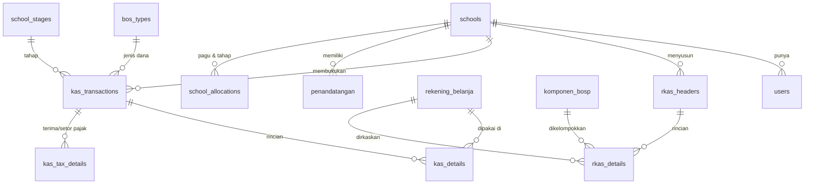

# 📘 BLUEPRINT APLIKASI SiapBOSP

**Sistem Informasi Akuntansi & Pertanggungjawaban Dana BOSP — Multi Sekolah**

- Versi dokumen: **0.1 (draft validasi)**
- Tanggal: 12 Oktober 2026
- Acuan pencatatan: *Manual Simakda BOS 2023, Dinas Pendidikan Kota Makassar* (`manual_bok_simakda_bos.pdf`)
- Stack: **Laravel 11+ / PHP 8.3 / PostgreSQL 16** • Multi-tenant satu database • Panel admin (rekomendasi: FilamentPHP)

---

## 1. Latar Belakang & Tujuan

Saat ini pembukuan dana BOS di sekolah mengikuti pola Simakda BOS (login web → pencatatan penerimaan/pengeluaran → laporan). Aplikasi ini dibangun agar:

1. Satu sekolah **dapat membukukan sendiri** dananya (mandiri), tapi
2. **Seluruh sekolah memakai aplikasi yang sama** (multi-tenant, data tiap sekolah terisolasi), dan
3. **Admin pusat (Dinas)** bisa memantau progres penyerapan & konsolidasi laporan lintas sekolah.

Modul terpadu: **Perencanaan (RKAS-BOSP) → Pembukuan (penerimaan/pengeluaran) → Pelaporan (BKU, realisasi, LPJ)**.

---

## 2. Pengguna & Peran

| Peran | Lingkup | Kemampuan utama |
|---|---|---|
| **Superadmin** | Aplikasi | Kelola tenant sekolah, master referensi global, user dinas, backup |
| **Admin Dinas (admin pusat)** | Semua sekolah (baca/monitor) | Pantau progres & serapan, konsolidasi laporan, broadcast pengumuman, kunci/buka periode tahap |
| **Operator/Bendahara Sekolah** | Sekolahnya | Input RKAS, penerimaan, pengeluaran, setor pajak, cetak laporan |
| **Kepala Sekolah** | Sekolahnya | Persetujuan (approve) RKAS & laporan, penandatangan final |
| **Viewer Sekolah** *(opsional)* | Sekolahnya | Hanya baca |

> Per-pengguna hanya terikat **satu** school_id (kecuali superadmin & dinas). Implementasi via `spatie/laravel-permission` + global scope tenant.

---

## 3. Alur Bisnis Tahunan (per Tahun Anggaran)

```
Dinas set pagu & tahap → Sekolah susun RKAS (per komponen/rekening)
→ Kepala Sekolah approve RKAS → DANA CAIR per tahap (PENDAPATAN)
→ Pelaksanaan kegiatan → BELANJA (+ TERIMA PAJAK otomatis melekat)
→ SETOR PAJAK (dengan NTPN) / SETOR UTANG PAJAK
→ Manajemen kas: AMBIL SIMPANAN (bank→tunai) / MUTASI TUNAI KE BANK
→ BKU otomatis terbentuk → Tutup buku per tahap
→ LAPORAN: per tahap / semester / tahun, realisasi vs RKAS, LPJ
→ Admin Dinas: monitoring & konsolidasi
```

---

## 4. Struktur Menu (Sitemap)

### Panel Sekolah
```
📊 Dashboard (saldo tunai & bank, serapan %, status tahap, pengumuman dinas)
📝 PERENCANAAN
   ├─ RKAS-BOSP (header + rincian per rekening/komponen, revisi, cetak)
   └─ Ringkasan Anggaran (total per komponen vs pagu)
📥 PENERIMAAN                      ← sesuai manual
   ├─ Pendapatan (dana hibah per jenis BOS + tahap)
   ├─ Ambil Simpanan (bank → tunai)
   └─ Mutasi Tunai ke Bank (tunai → bank)
📤 PENGELUARAN                      ← sesuai manual
   ├─ Belanja (header ARKAS + rincian rekening + terima pajak/kode billing)
   ├─ Setor Pajak (pilih No BKU belanja + NTPN)
   └─ Setor Utang Pajak
📒 PEMBUKUAN
   ├─ BKU (auto, per bulan/tahap)
   ├─ Kas Tunai & Kas Bank
   └─ Tutup Buku per Tahap
🖨️ LAPORAN
   ├─ Laporan Realisasi vs RKAS
   ├─ Laporan per Tahap/Semester (Cetak + Excel/PDF)
   └─ LPJ & Arsip Unggahan (kwitansi/bukti)
⚙️ UTILITY                          ← sesuai manual
   ├─ Profil Sekolah (provinsi, kab/kota, kecamatan, desa/kelurahan)
   ├─ Penandatanganan (NIP, nama, pangkat, jabatan)
   └─ Pengguna Sekolah
```

### Panel Admin Dinas
```
📊 Dashboard Wilayah (jumlah sekolah, serapan rata-rata, antrian approve)
🏫 Sekolah (aktivasi, reset user, pagu & tahap per sekolah)
📈 Monitoring Progres (matriks sekolah × tahap, filter kecamatan)
🗂️ Konsolidasi Laporan (rekap wilayah, ekspor)
🧩 Referensi Global (rekening belanja, rekening pajak, komponen BOSP, tahun)
📣 Pengumuman
```

---

## 5. Desain Database (PostgreSQL)

### 5.1 Prinsip
- **Single-database, shared-schema**: semua tabel transaksional berkolom `school_id` (FK → `schools`), dijaga **Laravel Global Scope** + middleware tenant → data antar sekolah pasti terisolasi.
- Master referensi (rekening, pajak, komponen, jenis BOS) **global** (kelola dinas); sekolah tidak menambah sendiri.
- Semua tabel: `id` BIGSERIAL/UUID, `created_by`, `updated_by`, `deleted_at` (soft delete) + tabel `audit_logs`.
- Waktu basis: `tz Asia/Makassar` (WITA).

### 5.2 ERD ringkas



### 5.3 Tabel utama (ringkas + kolom kunci; DDL penuh dibuat saat implementasi)

| Tabel | Fungsi | Kolom kunci |
|---|---|---|
| `schools` | Tenant sekolah | `npsn`(unik), nama, jenjang(SD/SMP/SMA/SMK/SLB), desa/kelurahan, kecamatan, kab_kota, provinsi, status aktif |
| `users` | Akun | school_id nullable, email, password, role |
| `fiscal_years` | Tahun anggaran | tahun, is_active |
| `bos_types` | Jenis BOS | kode: `reguler`, `kinerja`, `silpa`… |
| `komponen_bosp` | Komponen belanja | kode, nama *(seed 12 komponen BOSP reguler, bisa disesuaikan dinas)* |
| `school_stages` | Tahap penyaluran | school_id, fisyear, urutan, batas_tanggal, is_locked |
| `school_allocations` | Pagu sekolah | school_id, fisyear, bos_type, tahap, nilai pagu |
| `rekening_belanja` | Master kode rekening | kode(Build versions: pendapatan hibah + belanja opsi), nama, komponen_id, parent, level |
| `rekening_pajak` | Master pajak | kode, nama (PPN, PPh 21/22/23/4(2)) |
| `rkas_headers` | RKAS | school_id, fisyear, revisi_ke, status(draft/ajukan/disetujui/dikunci), no_surat, tgl |
| `rkas_details` | Rincian RKAS | header_id, rekening_id, uraian, satuan, banyak, harga_satuan, jumlah, sumber_dana |
| `kas_transactions` | **Header semua transaksi** (satu tabel, kolom `type`) | type ∈ {`pendapatan`,`ambil_simpanan`,`mutasi_tunai_ke_bank`,`belanja`,`setor_pajak`,`setor_utang_pajak`}, no_bku(auto), no_bukti(ARKAS), tgl_transaksi, bos_type_id, stage_id, metode_bayar(tunai/transfer), arah_kas(tunai↔bank), keterangan, total |
| `kas_details` | Rincian transaksi | transaction_id, rekening_id, uraian, nilai (+`kas_arah` tunai/bank) |
| `kas_tax_details` | Pajak per transaksi | transaction_id, rekening_pajak_id, kode_billing, ntpn, nilai, status(terima/belum_setor/sudah_setor), setor_transaction_id (link ke setor pajak) |
| `penandatangan` | Utility penandatanganan | school_id, nip, nama, pangkat, jabatan(kepsek/bendahara/ketua tim BOS), is_active |
| `announcements` | Pengumuman dinas | judul, isi, target (semua/kecamatan) |
| `staged_reports` | Arsip laporan | school_id, jenis, periode, path file, approved_by |
| `audit_logs` | Jejak semua aksi | user_id, model, aksi, before/after JSON |

### 5.4 Aturan bisnis penting
1. **BKU otomatis**: nomor urut per (sekolah, bulan) dari semua `kas_transactions` terurut tanggal & waktu input.
2. **Kas tunai vs bank selalu konsisten**: `ambil_simpanan` (+tunai/-bank), `mutasi_tunai_ke_bank` (+bank/-tunai), `pendapatan` (+bank), `belanja` tunai/transfer menyesuaikan metode_bayar. Sistem hitung saldo berjalan; **tolak** transaksi yang membuat saldo kas negatif.
3. **Belanja & pajak 3 form (sesuai manual)**: header (no bukti ARKAS, jenis BOS, tahap, metode) → rincian rekening → **form terima pajak** (kode billing) status *belum disetor*. Menu **Setor Pajak** wajib memilih **No BKU belanja** + isi **NTPN**. **Setor Utang Pajak** untuk akumulasi pajak setor terpisah.
4. **Validasi anggaran**: input belanja dicek terhadap RKAS (per rekening) & pagu tahap — mode aturan *warning* atau *hard-block* (di-set dinas).
5. **Tutup buku per tahap**: sekolah mengunci tahap; setelah terkunci transaksi tahap itu read-only; dinas bisa buka kembali.
6. **Approve berjenjang**: RKAS & laporan LPJ memakai status Draft → Diajukan → Disetujui (Kepsek).

---

## 6. Arsitektur Teknis Laravel

```
Browser sekolah/dinas
      │ HTTPS
   Nginx → Laravel 11 (PHP 8.3-FPM)  ──► PostgreSQL 16
            ├─ Auth (Sesi aja) + RBAC
            ├─ Tenant Middleware (resolve school dari user)
            ├─ Global Scope: where('school_id', current())
            ├─ FilamentPHP Panel (CRUD + aksi kustom)
            ├─ Cetak: dompdf/snappy · Excel: maatwebsite/excel
            ├─ Queue + Scheduler (reminder tahap, backup)
            └─ Storage: lampiran kwitansi/bukti (disk lokal/S3)
```
- **Paket rekomendasi**: `filamentphp/filament`, `spatie/laravel-permission`, `maatwebsite/excel`, `barryvdh/laravel-dompdf`, `owen-it/laravel-auditing`.
- **Deploy produksi** (nanti): VPS 1–2 vCPU (awal), PostgreSQL managed/self, backup harian + uji restore, HTTPS (Let's Encrypt), timezone WITA.

---

## 7. Keamanan & Tata Kelola Data
- RBAC ketat + isolasi tenant di-lintas (scope + test otomatis kebocoran lintas sekolah).
- Password hashing bawaan Laravel (bcrypt/argon2), throttle login, audit read/write aksi sensitif.
- Soft delete di semua data transaksi; penghapusan permanen hanya superadmin.
- Backup DB harian (retensi 30 hari); file lampiran terbackup.
- Halaman cetakan laporan memakai water-mark nama/NPSN sekolah.

---

## 8. Roadmap (rekomendasi fase)

| Fase | Isi | Selesai saat |
|---|---|---|
| **F0 — Blueprint** ✔️ | Dokumen ini divalidasi | … |
| **F1 — Fondasi** | Auth, multi-tenant, roles, profil sekolah, penandatangan, master referensi + seed | Login & utility jalan |
| **F2 — Perencanaan** | RKAS header/detail, ringkasan vs pagu, cetak | RKAS lengkap |
| **F3 — Pembukuan inti** | Penerimaan, pengeluaran+pajak, kas tunai/bank, BKU auto, tutup buku | Pembukuan lancar |
| **F4 — Pelaporan** | Realisasi vs RKAS, per tahap/semester, LPJ, arsip unggah | Siap dinas audit |
| **F5 — Panel Dinas** | Monitoring wilayah, konsolidasi, pengumuman, kontrol tahap | Siap dipakai kota |
| **F6 — Penguatan** | Notifikasi, impor Dapodik awal, API dasar, help/manual in-app | Produksi matang |

---

## 9. Yang Perlu Divalidasi Pak (sebelum coding)

1. **Nama final aplikasi**: pakai *SiapBOSP* atau lain (mis. *SIPaBOS / SIMAKDA-NGA*)?
2. **Jenjang cakupan**: SD/SMP saja atau termasuk **SMA–SMK–SLB** (komponen BOSP-nya sedikit berbeda)?
3. **Aturan belanja vs RKAS**: pelanggaran diikat *diblokir* atau *peringatan saja*?
4. **Bahasa & bahasa daerah**: UI Indonesia saja cukup?
5. **Integrasi ke depan**: perlu impor data NPSN sekolah (Dapodik) massal di awal?
6. **Laporan baku**: ikuti format LPJ Simakda Makassar yang berjalan, atau format LPJ standar Juknis BOSP terbaru?
