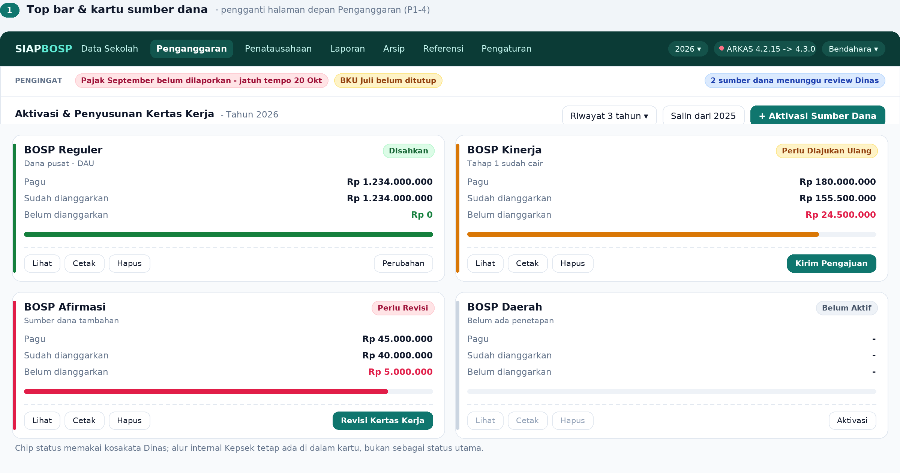
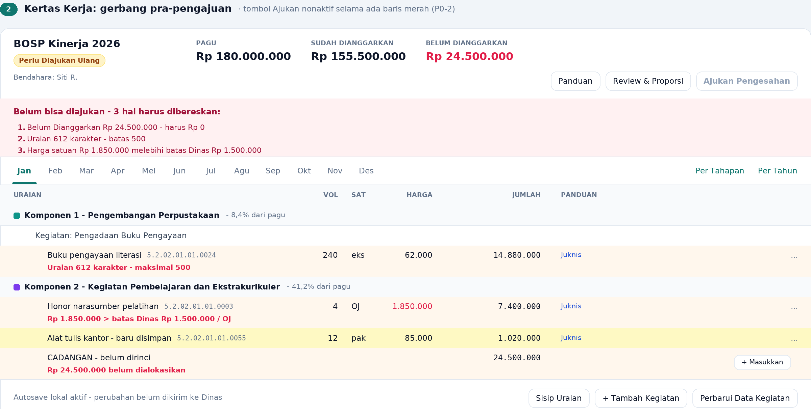
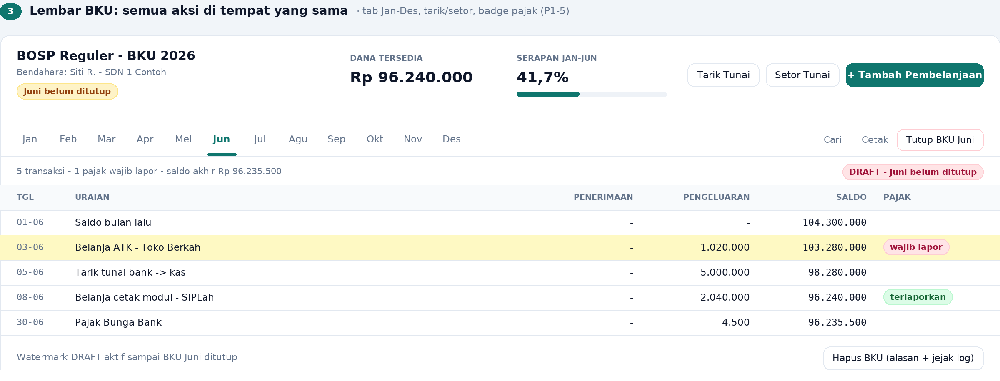
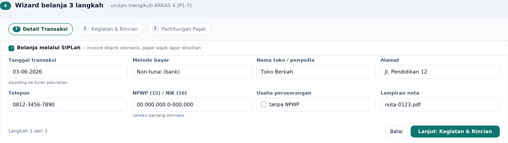
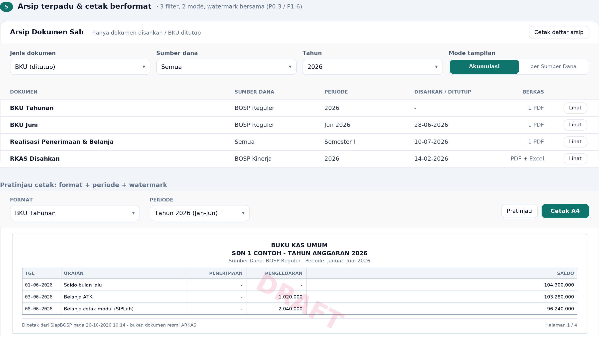

# Masukan untuk SiapBOSP dari ARKAS 4 — Menu, Tampilan, dan Kosakata

**Tanggal:** 26 Oktober 2026
**Lingkup:** inventaris menu + anatomi tampilan ARKAS 4 (v4.2.x–4.3.0), dibandingkan dengan SiapBOSP `main@8eb212c`, lalu diterjemahkan menjadi masukan konkret.
**Sifat dokumen:** masukan (belum ada kode yang diubah). Implementasi menunggu pilihan prioritas.

---

## 0. Ringkasan eksekutif

1. **SiapBOSP sudah unggul secara cakupan.** 47 item menu vs ±25 layar ARKAS 4. Yang kurang **bukan modul**, tapi **kosakata status**, **gerbang pra-pengajuan**, dan **penyatuan arsip**.
2. **Tiga masukan P0:** (a) peta kosakata status RKAS agar sama dengan istilah Dinas, (b) checklist pemblokir sebelum "Ajukan", (c) satu halaman Arsip dengan filter *jenis dokumen × sumber dana × tahun* + mode *Akumulasi* vs *per Sumber Dana*.
3. **Masukan P1 tampilan:** daftar dokumen per tahun + tab sumber dana di Penganggaran/Penatausahaan, grid 12 kotak bulan pada BKU, dan dropdown **Format + Periode** pada cetak BKU.
4. **Yang sudah setara dan tidak perlu dikerjakan ulang:** watermark **DRAFT** (`pembukuan/bku-cetak.blade.php`), Aktivasi Kertas Kerja (`RkasController`), Grafik Proporsi, badge "wajib lapor" (`pengeluaran/belanja.blade.php`), Tutup BKU, Buku Pembantu/SPTJM semester, Riwayat Import/Ekspor.
5. **Jangan tiru 4 hal dari ARKAS 4:** logout otomatis saat jendela ditutup, jendela data 3 tahun, `Tutup BKU` yang **wajib internet**, dan harga satuan yang dikunci server Dinas — SiapBOSP justru menang di situ.

> **Batas bukti:** artikel portal resmi berisi teks + tangkapan layar. **Tangkapan layar tidak dapat saya buka**, jadi detail tata letak di bawah **direkonstruksi dari daftar langkah beranotasi** (posisi tombol, urutan field), bukan dari gambar. Bagian yang murni dugaan ditandai *(dugaan)*.

---

## 0a. ⚠️ Koreksi — bukti tangkapan layar ARKAS 4 asli (21 Okt 2026)

Bagian 1–3 dokumen ini awalnya disusun dari **artikel teks** portal resmi karena tangkapan layarnya
tidak dapat dibuka di sandbox. Setelah pengguna mengirim **20 tangkapan layar ARKAS 4 v4.3.0** yang asli,
beberapa kesimpulan ternyata **salah** dan dikoreksi di bawah. Yang berlaku adalah tabel ini.

| Klaim awal (SALAH) | Yang benar (dari tangkapan layar) |
|---|---|
| Penganggaran/Penatausahaan/Arsip ada di **top bar** | Ketiganya ada di **sidebar kiri**, tanpa ikon, aktif = biru terang penuh |
| Top bar berisi navigasi area kerja | Top bar **hanya** logo ARKAS + **nama sekolah berdropdown** (avatar ⓤ) |
| "Perbarui Aplikasi" di top bar dengan titik merah | Ada di **bawah sidebar**, bersama Tutorial · Pertanyaan Umum · Hubungi Kami |
| Menu Profil berisi Data Sekolah, Tahun Anggaran, Sumber Dana, dst. | Isinya **hanya dua**: *Data Penanggung Jawab* dan *Keluar* |
| Penganggaran = **kartu-kartu per sumber dana** | **Tab sumber dana** di atas (BOSP Reguler · BOSP Daerah · BOSP Kinerja · SiLPA BOSP Kinerja · Lainnya · Sumber Dana Tambahan), isinya **daftar dokumen per tahun** |
| Status: *Draf, Perlu Revisi, Perlu Diajukan Ulang, terkirim…* | Yang terlihat di aplikasi: **Sudah Disahkan** (hijau), **Belum Aktif**, **Nonaktif - Lewat Batas**, **Aktif**, **Sudah Selesai**, **Draf** (biru), **Belum Dibuat** |
| BKU memakai tab Jan–Des memanjang | BKU memakai **grid 12 kotak bulan (4×3)** dengan tanda ✓ |

Pola penting yang baru terlihat dan wajib ditiru:

1. **Baris per tahun anggaran.** Tiap dokumen tampil sebagai baris berisi nama + chip status +
   keterangan versi (`Ver. Pergeseran - 29 Sep 2026`) + 3 ikon di kanan (buka/tutup, hapus, cetak).
   Riwayat **3 tahun** tampil sekaligus dalam satu daftar.
2. **Aktivasi manual.** Saat belum aktif: chip abu *Belum Aktif* + tombol hitam
   **Aktivasi Kertas Kerja / Aktivasi BKU** + keterangan kecil *"membutuhkan koneksi internet"*.
3. **Tenggat aktivasi.** Tahun yang lewat tenggat menampilkan *Nonaktif - Lewat Batas* beserta
   alasannya ("melewati tenggat 31 Des 2025").
4. **Modal Data Penanggung Jawab**: pemilih **tahun** + **Periode 1** (Bulan Awal *Januari* – Bulan Akhir
   *Desember*) + Nama/NIP Kepala Sekolah, Nama/NIP Bendahara, Nama/Email Komite.
   Keterangan: *"Anda dapat memasukkan data penanggung jawab yang berbeda untuk periode waktu yang berbeda."*
5. **Arsip**: tiga dropdown sejajar kanan — **Format** (BKUs / RKAS / Semua Format) ×
   **Sumber dana** × **Tahun** (2018…2021, Semua) — lalu daftar dokumen sah + tombol **Cetak**.
6. **Sumber Dana Tambahan** punya filter sumber dana sendiri + tombol **Unduh dan Perbarui Data**
   dengan dialog konfirmasi "Berhasil Perbarui Data".

> **Konsekuensi:** mockup `docs/mockup/01-penganggaran-kartu.png` (panel "kartu per sumber dana")
> dan `docs/mockup-paritas-arkas4.html` **tidak akurat** untuk bagian itu — lihat catatan di
> [`mockup/README.md`](mockup/README.md). Struktur yang sudah diimplementasikan di SiapBOSP mengikuti
> tabel koreksi di atas.

---

## 1. Metode & tingkat keyakinan sumber

| Tingkat | Sumber | Dipakai untuk |
|---|---|---|
| **A — Resmi** | Portal Pusat Informasi Kemendikdasmen (`pusatinformasi.kemendikdasmen.go.id`), artikel ID | Nama menu, tombol, status, alur, format cetak |
| **A — Regulasi** | Persesjen 13/2022 (daftar jenis dokumen) via salinan disdikbud | Daftar dokumen wajib (BKU, Buku Pembantu, SPTJM, dst.) |
| **B — Sekunder** | blog operator/guru (`websiteedukasi`, `e-ujian`, `informasiguru`, `opssekolah`, `fnanofficial`, `kiakrikil`) | Hanya konfirmasi silang; **tidak** dipakai untuk klaim angka |
| **C — Tidak terverifikasi** | klaim "28 format RKAS", salinan PDF panduan v4.1.9/4.2.2 untuk fliphtml5/slideshare | Tidak dipakai |
| **Blokir** | `arkas.kemendikdasmen.go.id/download/arkas4` | Tertahan WAF SafeLine → changelog hanya dari cuplikan mesin pencari |

**Konsekuensi:** angka "28 format" **tidak** saya pakai. Yang resmi menyebut **14 format RKAS**, dan daftar dokumen Persesjen 13/2022 memberi 9–10 jenis dokumen cetak.

---

## 2. Inventaris menu ARKAS 4

Navigasi global sangat sedikit dibanding 7 grup SiapBOSP — **3 area kerja di sidebar**,
top bar hanya identitas (lihat §0a untuk koreksi):

```
┌──────────────────────────────────────────────────────────────────────────────┐
│ ▲ARKAS                                              ⓤ UPT SPF SD NEGERI … ▾ │  top bar
├───────────────┬──────────────────────────────────────────────────────────────┤
│ Penganggaran  │                                                              │  sidebar
│ Penatausahaan │   (isi area kerja yang dipilih)                              │
│ Arsip         │                                                              │
│ ───────────── │                                                              │
│ ⓘ Tutorial    │                                                              │
│ ▤ Pertanyaan… │                                                              │
│ ◎ Hubungi…    │                                                              │
│ ↻ Perbarui…   │                                                              │
└───────────────┴──────────────────────────────────────────────────────────────┘
```

Isi dropdown nama sekolah: **Data Penanggung Jawab** dan **Keluar** (hanya dua).

| Area | Isi | Catatan tampilan |
|---|---|---|
| **Penganggaran** | **Tab sumber dana** (BOSP Reguler · BOSP Daerah · BOSP Kinerja · SiLPA BOSP Kinerja · Lainnya · Sumber Dana Tambahan) → **daftar dokumen per tahun** | Riwayat **3 tahun** sekaligus; tiap baris punya chip status + `Ver. …` + ikon buka/hapus/cetak |
| **Penatausahaan** | Daftar sumber dana → status BKU, **Aktivasi BKU**, 12 tombol bulan | Butuh KK **Disahkan** + dana salur + tahun lalu tertutup |
| **Arsip** | Filter **jenis dokumen × sumber dana × tahun** | **Hanya** dokumen sah; dua mode: *Akumulasi* / *per Sumber Dana* |
| **Perbarui Aplikasi** | Di **bawah sidebar** (bukan top bar), bersama Tutorial/Pertanyaan Umum/Hubungi Kami | Ikon ↻ + teks, bukan tombol |
| **Dropdown nama sekolah** | **Data Penanggung Jawab** (modal: tahun + Periode 1 + Kepsek/Bendahara/Komite) dan **Keluar** | Hanya dua item |

### 2.1 Status per kartu sumber dana (kosakata resmi)

```
Belum Aktif → Draf → [terkirim] Menunggu Review Dinas → Disahkan
                 ↖ Perlu Revisi ↙        ↖ Perlu Diperbaiki ↗
                 Perlu Diajukan Ulang
```

| Status | Arti operasional |
|---|---|
| Belum Aktif | kartu ada, KK belum diaktivasi |
| Draf | masih disusun sekolah |
| Perlu Revisi | dikembalikan Dinas |
| Perlu Diajukan Ulang | sudah diperbaiki, belum dikirim lagi |
| Menunggu Review Dinas | terkirim |
| Disahkan | boleh lanjut ke BKU |
| Perlu Diperbaiki | catatan Dinas pada dokumen/anggaran |

Aksi per kartu: **Cek Status Terbaru**, **Kirim Pengajuan**, **Revisi Kertas Kerja**, **Perbarui Data Kegiatan**, **Pergeseran**, **Perubahan** (draf bisa dibatalkan lewat `(x)`).

### 2.2 Halaman Kertas Kerja (paling padat informasinya)

```
┌───────────────────────────────────────────────────────────────────────────┐
│ ← Kertas Kerja   BOSP Reguler 2026        [Panduan]        [Review] [⋯]   │
├───────────────────────────────────────────────────────────────────────────┤
│ Pagu Rp 1.234.000.000   Sudah Dianggarkan Rp 1.180.000.000                │
│                         Belum Dianggarkan Rp 54.000.000  ← merah, harus 0 │
├───────────────────────────────────────────────────────────────────────────┤
│ Jan │ Feb │ Mar │ Apr │ Mei │ Jun │ Jul │ Agu │ Sep │ Okt │ Nov │ Des     │
├───────────────────────────────────────────────────────────────────────────┤
│ 🔎 Cari kegiatan…                       [+ Tambah Kegiatan] [Perbarui]    │
│ ▸ Komponen  Kode  Uraian                 Vol  Sat   Harga   Jumlah  Aksi  │
│   ▸ Kegiatan …                                     …              [⋯]      │
│       rincian objek belanja …                                            │
└───────────────────────────────────────────────────────────────────────────┘
```

Detail perilaku yang penting ditiru:
- **`Belum Dianggarkan` harus Rp 0** sebelum "Ajukan Pengesahan"; kalau tidak, tombol pengajuan menolak.
- **Uraian maksimal 500 karakter**.
- **Harga satuan dibatasi** harga dari Dinas — input di atas batas ditolak.
- Tiap rincian punya **bulan** (Jan–Des); `+ Tambah Bulan` memperbanyak baris bulan.
- Aksi `(⋯)` → **Edit Detail Anggaran**, **Sisip Uraian**, **Hapus Semua**, **Batal**; ada `+ Masukkan Ke Anggaran`.
- **Autosave** hanya ke perangkat, bukan ke server.
- Kolom **Panduan** (ikon Juknis) di tiap baris.

### 2.3 Review

- Dikelompokkan **per periode salur** (2 tahap), komponen bisa **dilipat**.
- Tiap komponen punya **warna** konsisten.
- **Grafik Proporsi** membandingkan persentase komponen dengan **Juknis tahun berjalan** (bukan tahun lalu).

### 2.4 Penatausahaan → BKU

```
┌───────────────────────────────────────────────────────────────────────────┐
│ BOSP Reguler 2026 · BKU      Dana Tersedia Rp …   [Tarik Tunai][Setor Tunai]│
│ [Jan][Feb][Mar][Apr][Mei][Jun][Jul][Agu][Sep][Okt][Nov][Des]              │
│ [+ Tambah Pembelanjaan]  [🔎 Cari]  [🖨 Cetak]  [🔒 Tutup BKU]  [🗑 Hapus]│
├───────────────────────────────────────────────────────────────────────────┤
│ Tgl │ Uraian │ Penerimaan │ Pengeluaran │ Saldo │ Pajak                  │
│ ▓▓▓ baris baru = kilat kuning sesaat                                      │
│                                     ⚠ Pajak Wajib Lapor (merah)           │
└───────────────────────────────────────────────────────────────────────────┘
```

- Jan–Jun ada **progress bar** realisasi.
- **Hapus BKU** tidak langsung hapus → **Pengajuan hapus BKU** (jejak audit).
- **Tutup BKU** wajib internet; ada syarat Bunga Bank & Pajak Bunga ≤ bunga.
- Status **Belum Lapor Pajak** merah → hitam setelah isi **Tanggal Lapor + NTPN + Kirim Bukti Lapor**; jatuh tempo **tanggal 20 bulan berikutnya**.
- `Perubahan RKAS` **diblokir** bila ada bulan yang BKU-nya belum tutup.

### 2.5 Wizard belanja 3 langkah

```
(1) Detail Transaksi → (2) Kegiatan & Rincian → (3) Perhitungan Pajak
```
- Langkah 1: centang **SIPLah**, **tanggal transaksi = bulan pelunasan** (bukan tanggal nota), tunai/non-tunai, centang **usaha perseorangan**, nama/alamat/telepon toko, **NPWP 15 digit / NIK 16 digit**, centang **tanpa NPWP**.
- Jalur SIPLah menarik invoice/marketplace otomatis, lalu **Pajak Wajib Lapor langsung nol**.
- Jalur manual: isi pajak di langkah 3, ada centang "belanja di SIPLah".

### 2.6 Cetak & format

- Ada **dropdown Format** dan **dropdown Periode**; periode hanya terisi bila dokumen ada di **BKU Tahunan/Arsip**.
- **Watermark DRAFT** pada bulan yang belum ditutup.
- Sumber dana non-reguler **tidak punya** format "Tahapan" → harus pakai **BKU Tahunan/Arsip**.
- Format rujukan: RKAS (**14 format** resmi), BKU Bulanan/Tahunan/Tahapan, Rekapitulasi Realisasi (Semester), Buku Pembantu Kas/Bank/Pajak/Rincian Objek Belanja, Laporan Realisasi Penerimaan & Belanja (Semester), SPTJM, Rekapitulasi BMD.

---

## 3. Perbandingan ARKAS 4 vs SiapBOSP (berbasis kode)

| # | Aspek | ARKAS 4 | SiapBOSP sekarang (bukti) | Selisih |
|---|---|---|---|---|
| 1 | Navigasi | 3 area kerja di sidebar + top bar identitas | 3 area kerja utama + 3 grup tambahan + utilitas (`layouts/app.blade.php`) | ✅ disamakan |
| 2 | Halaman depan Penganggaran | tab sumber dana + daftar dokumen **per tahun** | `rkas.index`: 6 tab + satu baris per tahun (partial `_tab-sumber-dana`) | ✅ disamakan |
| 3 | Status KK | 7 status Dinas | 7 status internal (`RkasHeader::LABEL_STATUS`: draft, diajukan, disetujui, dikirim_dinas, revisi, disahkan, dikunci) | **Kosakata beda**, ada 2 tahap internal (Kepsek) |
| 4 | Gerbang "Ajukan" | Belum Dianggarkan = Rp 0, Uraian ≤500, harga ≤ batas Dinas | "Belum Dianggarkan" **ditampilkan**; pembatas 500 char & batas harga belum ada | **Belum memblokir** |
| 5 | Tab bulan KK | 12 tab | tab **Per Tahapan / Per Tahun** + select bulan | beda model, bukan kekurangan |
| 6 | Review | per periode salur, lipat, warna | `penganggaran.review` + Grafik Proporsi ✔ | setara |
| 7 | BKU | 12 tab bulan, aksi inline, kilat kuning | `<input type="month">`, aksi belanja di menu lain | **Aksi terpencar** |
| 8 | Tarik/Setor Tunai | tombol di lembar BKU | menu terpisah (`ambil.index`, `mutasi.index`) | setara fungsi, beda letak |
| 9 | Badge pajak | merah di BKU + pengingat tgl 20 | badge "wajib lapor" **hanya di daftar belanja** | **Belum di BKU/dashboard** |
| 10 | Hapus BKU | via pengajuan | 🔒 Tutup BKU ada; hapus transaksi **wajib beralasan** dan tercatat di `activity_logs` (`JejakHapus`) | ✅ jejak audit ada; alur pengajuan ke pusat tidak ditiru (offline) |
| 11 | Cetak BKU | dropdown Format + Periode | **satu format** (`bku-cetak.blade.php`) | **kurang 3 format** |
| 12 | Watermark DRAFT | semua cetak bulan berjalan | **semua cetakan** (`layouts.print` + dokumen `.dokumen`), status dihitung `StatusDraft` | ✅ disamakan |
| 13 | Arsip | 1 halaman, 3 filter, 2 mode | `/arsip` = 3 filter; sub-halaman memakai **partial filter bersama** (Tahun dari data, bukan rentang dipaku); `arsip/bku` kini berfilter | ✅ bentuk seragam; sub-halaman tetap ada |
| 14 | Wizard belanja | 3 langkah berlabel | 1 form (`belanja-form.blade.php`) + rute `hitung-pajak` terpisah | **tanpa stepper** |
| 15 | Sumber dana | 6–7 kartu, PAUD/Kesetaraan dikurangi | `RkasHeader::SUMBER_DANA_ARKAS` 7 nilai ✔ | setara |
| 16 | Riwayat | 3 tahun | semua tahun ✔ | **SiapBOSP lebih baik** |
| 17 | Tutup BKU | wajib online | offline ✔ | **SiapBOSP lebih baik** |

---

## 4. Masukan konkret

### P0-1 — Peta kosakata status (pekerjaan: kecil, dampak: besar) · ✅ sudah diimplementasikan

**Masalah.** Operator mengetik status ke Dinas dengan istilah ARKAS; di SiapBOSP ia melihat "Diajukan ke Kepsek" dan "Disetujui Kepsek" yang tidak ada padanannya.

**Usulan.** Jangan hapus alur internal (Kepsek), tapi tambah label ARKAS sebagai chip kedua:

| SiapBOSP `status` | Chip utama (tetap) | Chip ARKAS (baru) |
|---|---|---|
| `draft` | Draf | Draf |
| `diajukan` | Diajukan ke Kepsek | Draf (belum ke Dinas) |
| `disetujui` | Disetujui Kepsek | Siap Diajukan |
| `dikirim_dinas` | Menunggu Tinjauan Dinas | Menunggu Review Dinas |
| `revisi` | Perlu Revisi (Dinas) | Perlu Revisi |
| `disahkan` | Disahkan Dinas | Disahkan |
| `dikunci` | Dikunci | Diarsipkan |

**Yang sudah jadi:** `RkasHeader::LABEL_STATUS_ARKAS` (+ `labelStatusArkas()`, `nadaStatusArkas()`, `catatanStatusArkas()`, `statusArkasBerbeda()`) dan partial `resources/views/rkas/partials/status-arkas.blade.php` yang dipakai di `rkas/index` dan `rkas/show`. Chip internal tetap ditampilkan, chip ARKAS muncul di sampingnya. Tanpa migrasi DB.

### P0-2 — Gerbang pra-pengajuan (blocking checklist) · ✅ sudah diimplementasikan

**Masalah.** Sekarang "Ajukan" bisa ditekan walau ada sisa belum dianggarkan; ARKAS menolak.

**Yang sudah jadi** (`App\Services\PraAjukanRkasService::periksa()`):

| Pemeriksaan | Level | Efek |
|---|---|---|
| `Belum Dianggarkan` ≠ Rp 0 (kurang **atau** lebih dari pagu) | ⛔ blokir | pengajuan ditolak |
| Belum ada rincian sama sekali | ⛔ blokir | pengajuan ditolak |
| Rincian tanpa volume/harga/jumlah (> 0) | ⛔ blokir | pengajuan ditolak |
| Harga satuan > batas SSH/SBU Dinas | ⚠️ peringatan | tetap boleh, dicatat |
| Temuan proporsi Juknis (buku/sarpras/honor/tahap) | ⚠️ peringatan | blokirnya tetap di "Kirim ke Dinas" |

Tombol **Ajukan ke Kepsek** otomatis nonaktif (`@disabled`) selama ada blokir. Panel *Kelayakan Pengajuan* menampilkan tiap temuan beserta tautan langsung ke baris rincian (`#baris-{id}`), ada tombol **Periksa Ulang**, dan endpoint `GET /rkas/{id}/pra-ajukan` mengembalikan hasil yang sama dalam JSON. Aturan penolakan juga ditegakkan di sisi server pada `RkasController::aksi()` — bukan hanya di tampilan.

**Perbaikan ikutan (penting):** batas uraian ARKAS 4 adalah **500 karakter** dan form SiapBOSP sudah memakainya (`maxlength=500`, `max:500`), tetapi kolom `rkas_details.uraian` masih **VARCHAR(255)** — isian 256–500 karakter lolos validasi lalu terpotong (MySQL longgar) atau gagal simpan (PostgreSQL). Migrasi `2026_10_26_000001_widen_rkas_details_uraian.php` melebarkannya ke 500. Karena setelah itu uraian > 500 tidak mungkin tersimpan, pemeriksaan uraian tidak dijadikan item gerbang.

### P0-3 — Satu halaman Arsip · ✅ sudah diimplementasikan

**Masalah.** 5 halaman arsip, dan `arsip/bku` bahkan tanpa filter.

**Usulan.** Gabung jadi `/arsip` dengan 3 dropdown + 1 toggle:

```
Jenis dokumen: [RKAS disahkan ▾]   Sumber dana: [Semua ▾]   Tahun: [2026 ▾]
Tampilan: (•) Akumulasi   ( ) per Sumber Dana        [🖨 Cetak daftar]
```

**Yang sudah jadi:** `GET /arsip` (`arsip.index`, `ArsipController::index`) — tiga filter sejajar (Format × Sumber dana × Tahun), hanya memuat dokumen sah (RKAS disahkan/dikunci + BKU yang sudah ditutup), tiap baris punya tombol Buka & Cetak. Rute lama (`arsip.rkas`, `arsip.bku`, `arsip.pajak`, impor/ekspor) tetap hidup sebagai filter-preset agar tautan lama tidak mati.

### P1-4 — Halaman depan Penganggaran (tab sumber dana + baris per tahun) · ✅ sudah diimplementasikan

**Yang sudah jadi:** `rkas.index` memakai **tab sumber dana** (`RkasHeader::TAB_SUMBER_DANA`) dan **satu baris per tahun anggaran** dengan riwayat 3 tahun — persis ARKAS 4. Revisi pada tahun yang sama dilipat; seluruh revisi tetap dapat dibuka lewat tombol **Riwayat (n)**. Tahun aktif tanpa dokumen menawarkan **Aktivasi Kertas Kerja**; tahun lampau tanpa dokumen diberi chip *Nonaktif - Lewat Batas*. Tautan lama `?sumber=…` tetap dihormati.

Ikon hapus **tidak** ditambahkan karena belum ada rute hapus RKAS — lebih baik tidak ada tombol daripada tombol yang tidak berfungsi.

### P1-5 — Grid 12 kotak bulan + aksi cepat di BKU · ✅ sudah diimplementasikan

- **Sudah:** grid 12 kotak bulan (4×3) di **atas** tabel BKU sebagai pemilih bulan utama, dengan tanda ✓ untuk bulan
  yang sudah selesai/tertutup; `<input type="month">` dipertahankan sebagai "Lompat ke bulan".
- **Sudah:** aksi cepat **➕ Tambah Penerimaan Dana** (rute `pendapatan.index`) dan **➕ Tambah Pembelanjaan**
  (rute `belanja.create`) langsung di toolbar lembar BKU, jadi tidak perlu pindah menu. Keduanya tautan biasa
  (CSP `script-src-attr 'none'`), dan **disembunyikan saat bulan terkunci** — server memang sudah menolak
  pencatatan pada bulan tertutup lewat `cekBulan()`. Dijaga `BkuBulanTest` (2 test).
- **Sudah:** badge status per bulan, termasuk *⚠️ Belum Lapor Pajak* pada grid, serta pengingat tenggat tgl 20 di
  dashboard — padanan "Pajak Wajib Lapor" ARKAS.
- **Belum (sengaja):** **Tarik Tunai / Setor Tunai** sebagai tombol di lembar (rute `ambil`/`mutasi` sudah ada,
  tetapi ini perpindahan antar-kas, bukan tambah transaksi — ditempatkan di menu Penerimaan agar tidak
  membingungkan operator).
- **Sudah:** **kilat kuning** pada baris yang baru disimpan. Aksi cepat membawa `?kembali=bku`; setelah
  tersimpan `pendapatanStore`/`belanjaStore` mengembalikan operator ke
  `bku?bulan={ym}&baru={id}` dan baris dengan id itu memakai kelas `.kilat`
  (animasi CSS 2,6 detik, tanpa JavaScript; `prefers-reduced-motion` memakai warna tetap).
  Tanpa `?kembali=bku` perilaku lama tidak berubah: pendapatan kembali ke halaman asal,
  belanja kembali ke daftar belanja. Dijaga `BkuKilatBaruTest` (4 test).

### P1-6 — Dropdown Format + Periode pada cetak BKU · ✅ sudah diimplementasikan

Tambahkan `?format=` pada `pembukuan.bkuCetak`:

| Format | Isi | Status |
|---|---|---|
| Bulanan | bulan terpilih | ✅ (default, perilaku lama) |
| Tahunan | Jan–Des satu tahun | ✅ |
| Tahapan | per tahap salur | ✅ |
| Akumulasi | seluruh transaksi s/d bulan terpilih | ✅ |
| Rekapitulasi Realisasi (Semester) | `pembukuan.rekapRealisasi` | sudah ada (rute lain) |
| Buku Pembantu Rincian Objek Belanja | `pembukuan.bukuPembantu` | sudah ada (rute lain) |
| SPTJM | `pembukuan.sptjm` | sudah ada (rute lain) |

Sekaligus: **watermark DRAFT** dipindah jadi komponen bersama (`partials.watermark-draft`) yang dipakai **semua** cetak, bukan hanya BKU.

**Yang sudah jadi:**
- Toolbar cetak punya pemilih **Format** + **Periode** (dan **Tahap** saat format Tahapan) memakai `data-kirim-otomatis`, jadi tanpa atribut `onchange` (patuh CSP). Tombol `Terapkan` tetap ada sebagai cadangan tanpa JavaScript.
- Kontrak hitung tidak berubah: kolom **Saldo** selalu posisi kas sesungguhnya per baris, baris **Saldo Awal** = posisi kas tepat sebelum tanggal awal periode. Format hanya mengubah rentang.
- Blok penutup (Saldo Bank / Kas Tunai / Jumlah) memakai snapshot **baris terakhir yang dicetak**, sehingga tetap konsisten walau format Tahapan menyembunyikan baris tahap lain.
- Watermark DRAFT kini dihitung per **rentang**: bulanan = bulan itu saja, akumulasi = Januari s/d bulan terpilih, tahunan/tahapan = 12 bulan. Satu bulan terbuka saja sudah memunculkan DRAFT.
- Nama bulan/hari pada dokumen sekarang Indonesia eksplisit (tidak lagi bergantung `APP_LOCALE`, yang default-nya `en`).
- Format tak dikenal (`?format=ngawur`) jatuh ke Bulanan, bukan error.
- Pagar regresi: `tests/Feature/BkuCetakFormatTest.php` (8 test).

### P1-7 — Wizard belanja berlabel 3 langkah · ✅ sudah diimplementasikan

Susun ulang `belanja-form.blade.php` jadi stepper: **Detail Transaksi → Kegiatan & Rincian → Perhitungan Pajak**, dengan urutan field mengikuti ARKAS (SIPLah dulu, lalu tanggal = bulan pelunasan, NPWP 15/NIK 16, centang tanpa-NPWP, jenis usaha perseorangan). Rute `hitung-pajak` menjadi langkah 3 (bukan halaman lepas). Ini perubahan murni tampilan + validasi; skema DB tetap.

**Yang sudah jadi:**
- Stepper di puncak form (3 pil berlabel) + panel `role="tabpanel"` per langkah; hanya satu panel tampil.
- Lampiran bukti (kuitansi/nota) ikut **Langkah 1** karena itu bukti transaksi, bukan dokumen pajak.
- Tombol `← Kembali` / `Lanjut →` bertipe `type="button"` (bukan submit) dan memakai listener delegasi di JS — sesuai aturan CSP `script-src-attr 'none'` (R-03).
- Validasi per langkah: langkah tidak bisa ditinggalkan selama field wajib di langkah itu belum valid; pesan muncul di `#wizardPesan` dengan `aria-live="polite"`.
- Tetap **satu** `<form>` ke `belanja.store`; semua `name=` lama tidak berubah, jadi controller tidak disentuh. `💾 Simpan Belanja` hanya tampil di langkah 3 dan melakukan validasi ketiga langkah sekaligus.
- Ringkasan sebelum simpan (total belanja, pajak dipungut, sumber, metode bayar).
- Tanpa JavaScript, perilaku lama kembali utuh lewat `<noscript>`: ketiga panel terbuka dan tombol simpan tampil.
- Data yang sudah diketik tidak hilang saat mundur/maju karena panel hanya disembunyikan, bukan dibuang.
- Pagar regresi: `tests/Feature/WizardBelanjaTest.php` (urutan langkah, tombol non-submit, kelengkapan `name=`, lampiran di langkah 1, larangan `on*` inline).

### P2 — Kecil tapi murah · ✅ sudah diimplementasikan

| Usulan | Alasan | Status |
|---|---|---|
| Badge versi di topbar | meniru "Perbarui Aplikasi" | ✅ `config('app.version')` di topbar → `bantuan#versi` |
| Tombol tahun anggaran di topbar | ARKAS taruh di Profil; SiapBOSP punya `datasekolah.tahun` yang terkubur | ✅ sudah ada sebelumnya; **rentang tahunnya diperlebar dua arah** (`min(2023, tahun aktif)`–`max(2028, tahun aktif)`) agar tahun arsip 2021 maupun tahun depan tetap muncul terpilih |
| Footer cetak: *"Dicetak dari SiapBOSP — bukan dokumen resmi ARKAS"* | mencegah salah pakai di Dinas | ✅ di `layouts.print` **dan** jejak cetak `.cetak-kaki` di kerangka aplikasi, jadi berlaku juga untuk halaman dokumen (LPJ, Buku Pembantu) dan halaman biasa yang dicetak |
| Kolom **Panduan** (tautan Juknis) per baris rincian | dikerjakan sekali di partial | ✅ `partials/_panduan-rincian.blade.php` dipakai tabel rincian Kertas Kerja |

**Yang sudah jadi / catatan:**
- `config('app.version')` sebelumnya **tidak ada** di `config/app.php`; halaman Bantuan memanggilnya dengan fallback `v4.3.0` sehingga badge dan halaman selalu menampilkan angka cadangan. Kunci config-nya kini ditambahkan (bisa ditimpa lewat `APP_VERSION`), jadi versi punya satu sumber.
- **Versi SiapBOSP dipisahkan dari acuan ARKAS** (`app.arkas_acuan` / `ARKAS_ACUAN`). Sebelumnya angka "ARKAS 4 v4.3.0" ditulis harfiah di **enam** tempat — footer kerangka, judul badge versi, halaman Bantuan, panel pajak wizard belanja, subtitle Kertas Kerja, dan pesan kelengkapan review — sehingga update ARKAS berisiko meninggalkan teks basi. Sekarang satu kunci config; menjalankan `php artisan config:cache` sesudah mengubahnya. Memperbarui ARKAS di laptop **tidak** mengubah versi SiapBOSP: versi ARKAS yang terpasang tetap dideteksi terpisah oleh `VersiArkasService` (menu *Pengaturan › Deteksi Versi*). Dijaga `tests/Feature/VersiAcuanTest.php` (5 test).
- Badge hanya tampil di layar ≥ `md` (kelas dipilih dari CSS yang sudah ter-build; `sm:flex`/`sm:block` tidak ada di build sehingga tidak mungkin dipakai tanpa build ulang aset).
- Footer cetak **ikut tercetak** (tanpa kelas `nonprint`) dan memuat versi, waktu cetak, nama sekolah, dan tahun anggaran.
- Kolom Panduan berisi tiga tautan per baris: **Aturan uraian & proporsi** (`bantuan#rincian`, bagian baru di halaman Bantuan), **Standar harga rekening ini** (`referensi.harga?q=<kode rekening>`), dan **Review & proporsi** (`penganggaran.review`). Semua rute internal — tidak ada ketergantungan internet.
- Halaman Bantuan dapat dua anchor (`#versi`, `#rincian`) dengan `scroll-margin-top` inline karena kelas `scroll-mt-24` tidak ter-build.
- **Celah yang ditutup saat verifikasi ulang:** disclaimer dulu hanya ada di `layouts.print`. Padahal LPJ per Tahap dan Buku Pembantu memakai kerangka aplikasi (`.dokumen`), dan halaman apa pun bisa dicetak dengan Ctrl+P — semuanya tercetak tanpa pernyataan apa pun. Kini kerangka aplikasi membawa `<div class="cetak-kaki">` yang `display:none` di layar dan `display:block` di `@media print`, memuat versi, waktu cetak, dan nama sekolah.
- **Verifikasi ulang (2026-10-26):** keempat item dicek satu per satu terhadap kode, bukan hanya terhadap catatan ini. Dua celah ditemukan dan ditutup — (a) disclaimer cetak dulu hanya ada di `layouts.print`, padahal halaman dokumen memakai kerangka aplikasi; (b) pilihan tahun anggaran dipaku 2023 di sisi bawah sehingga sesi tahun arsip (2021) tidak punya opsi terpilih.
- Pagar regresi: `tests/Feature/P2ArkasParitasTest.php` (8 test) + `tests/Feature/VersiAcuanTest.php` (5 test) — termasuk jejak cetak di halaman biasa **dan** halaman dokumen, aturan CSS yang hanya aktif saat cetak, serta tahun anggaran di luar rentang bawaan (2031 dan 2021) yang tetap terpilih.


---

## 3a. Sisa paritas yang memang belum sama

Dicek ulang 2026-10-26 terhadap kode. Empat celah besar sudah ditutup (jejak hapus,
watermark semua cetak, tab sumber dana, filter arsip seragam). Yang masih berbeda:

| Hal | ARKAS 4 | SiapBOSP | Sifat |
|---|---|---|---|
| Pita tab di **semua** halaman | ada di setiap layar | ada di 3 halaman yang benar-benar menyaring (Kertas Kerja, Pendapatan, Belanja) | sengaja: tab tanpa penyaringan = tab mati |
| Tombol Tarik/Setor Tunai di lembar BKU | ada | di menu Penerimaan | sengaja: perpindahan antar-kas, bukan tambah transaksi |
| Tab *Sumber Dana Tambahan* | select sumber + "Unduh dan Perbarui Data" | kartu keterangan + tab dokumen | belum: butuh layanan pusat |
| Utilitas bawah sidebar | 4 (Tutorial · Pertanyaan Umum · Hubungi Kami · Perbarui Aplikasi) | 2 (Bantuan & Panduan · Perbarui Aplikasi) | belum |
| Ikon baris ✎ 🗑 🖨 | tiga aksi | Buka/PDF/Excel, tanpa hapus RKAS | sengaja: rute hapus RKAS belum ada |
| Aktivasi BKU / Tutup BKU wajib internet | ya | tidak (offline) | sengaja — nilai jual SiapBOSP |

## 4a. Sistem tampilan (dipakai semua halaman)

Rupa seluruh halaman diatur dari satu tempat: `resources/css/app.css` (token `@theme` +
kelas komponen `@layer components`) dan `resources/views/layouts/_gaya-darurat.blade.php`
(jalur tanpa build). Palet ARKAS (biru `#1a56db`, sudut tegas, kartu pipih) dipasang
sebagai pemetaan token sehingga satu perubahan berlaku untuk semua halaman.
Rincian, aturan menambah UI, dan cara build ulang aset: [`SISTEM-TAMPILAN.md`](SISTEM-TAMPILAN.md).

## 4b. Gambar tampilan usulan

Berkas PNG di `docs/mockup/` (digambar manual dengan Pillow, teks & angka identik dengan dokumen ini — **bukan** hasil AI generator). Sumber: `docs/mockup/render_mockup.py`.

| Gambar | Menunjukkan | Terkait |
|---|---|---|
|  | ⚠️ **tidak akurat** (dibuat sebelum ada tangkapan layar). Struktur ARKAS 4 yang benar: tab sumber dana + baris per tahun — lihat §0a | P0-1, P1-4 |
|  | **Gerbang pra-pengajuan**: tombol *Ajukan* nonaktif, 3 pelanggaran disorot, baris baru kilat kuning | P0-2 |
|  | **BKU**: tab Jan–Des, tarik/setor tunai di lembar, badge **wajib lapor** | P1-5 |
|  | **Wizard 3 langkah** mengikuti urutan ARKAS | P1-7 |
|  | **Arsip terpadu** (3 filter + 2 mode) & pratinjau cetak ber-watermark **DRAFT** | P0-3, P1-6 |

Lembar gabungan semua panel: [`mockup/00-semua-tampilan.png`](mockup/00-semua-tampilan.png). Cara regenerasi ada di [`mockup/README.md`](mockup/README.md).

---

## 5. Yang sebaiknya *tidak* ditiru

| Perilaku ARKAS 4 | Alasan tidak ditiru |
|---|---|
| Logout otomatis saat jendela ditutup | menyulitkan operator yang membuka SiapBOSP di tab lain |
| Riwayat dibatasi 3 tahun | SiapBOSP arsip lokal = nilai jual; tetap simpan semua |
| `Tutup BKU` wajib internet | SiapBOSP bisa tutup offline — pertahankan, cukup beri catatan |
| Harga satuan dikunci server Dinas | SiapBOSP harus jalan tanpa server; cukup **peringatan** batas |
| Hapus BKU lewat pengajuan ke pusat | untuk SiapBOSP cukup **soft-delete + alasan + jejak** di `Log Sistem` |

---

## 6. Urutan pengerjaan yang disarankan

| Sprint | Isi | Risiko | Alasan urutan |
|---|---|---|---|
| **S1** | ✅ P0-1 kosakata status + P0-2 gerbang ajukan (selesai) | rendah | mencegah salah kirim ke Dinas |
| **S2** | P0-3 arsip terpadu | sedang (rute baru) | memperbaiki temuan operator paling sering |
| **S3** | ~~P1-5 tab BKU + badge pajak + aksi cepat + kilat kuning~~ ✅ · ~~P1-6 format cetak~~ ✅ | sedang | selesai |
| **S4** | P1-4 kartu sumber dana | sedang | mengubah halaman depan `rkas.index` |
| **S5** | ~~P1-7 wizard belanja~~ ✅ | sedang–tinggi (form sentral) | selesai — lihat `WizardBelanjaTest` |
| **S6** | ~~P2 sekumpulan kecil~~ ✅ | rendah | selesai |

Tiap sprint: `php artisan test`, uji cetak (A4), dan cek `Belum Dianggarkan` pada data nyata.

---

## 7. Sumber

**Resmi (A)** — portal Pusat Informasi Kemendikdasmen, artikel ID:
- Fitur Utama ARKAS 4 — `/hc/id/articles/52435404891033-Fitur-Utama-ARKAS-4`
- Mengisi Kertas Kerja ARKAS 4 — `/hc/id/articles/52435547420953-Mengisi-Kertas-Kerja-ARKAS-4`
- Mencatat Pembelanjaan … Detail Transaksi — `/hc/id/articles/52436500639001`
- Cara Cetak BKU ARKAS 4 — `/hc/id/articles/52436938890777-Cara-Cetak-BKU-ARKAS-4`
- Menyelesaikan / Tutup BKU ARKAS 4 — `/hc/id/articles/52436300614297`
- Lapor Pajak ARKAS 4 — `/hc/id/articles/52436721740697`
- Perubahan RKAS — `/hc/id/articles/52436006354585`
- Pemeliharaan Sistem MARKAS/ARKAS — `/hc/id/articles/52435338737945`

**Regulasi (A)** — Persesjen Kemendikbudristek 13/2022 (daftar jenis dokumen laporan), salinan resmi disdikbud.

**Sekunder (B, hanya konfirmasi)** — `websiteedukasi.com`, `e-ujian.id`, `informasiguru.com`, `opssekolah.com`, `fnanofficial.id`, `kiakrikil.com`.

**Tidak dipakai** — klaim "28 format RKAS" (hanya di sumber B) dan salinan panduan v4.1.9/4.2.2 di fliphtml5/slideshare.

**Catatan akses** — `arkas.kemendikdasmen.go.id/download/arkas4` tertahan WAF; changelog 4.2.16–4.3.0 hanya terbaca lewat cuplikan mesin pencari (Afirmasi/Sumber Dana Tambahan, komponen per Juknis 2026, perbaikan cetak Afirmasi/SDT, 6 laporan BKU Tahunan di area Penganggaran).

---

*Dokumen ini masukan, bukan komitmen implementasi. Mockup interaktif: `docs/mockup-paritas-arkas4.html` · gambar PNG: `docs/mockup/`.*
