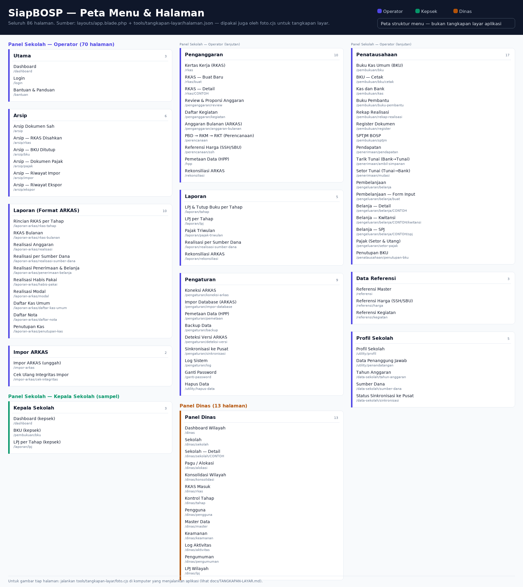

# Tangkapan Layar Semua Menu & Halaman

> **Status:** alat siap, **gambar belum ada**. Screenshot tidak bisa dibuat di
> lingkungan kerja asisten (lihat §1); alatnya harus dijalankan di komputer yang
> menjalankan aplikasi. Dokumen ini menjelaskan sebabnya, apa yang akan diambil,
> dan cara mengirim hasilnya balik.



*Peta struktur menu — **bukan** tangkapan layar aplikasi. Dibuat dari
`tools/tangkapan-layar/halaman.json` (daftar yang sama dengan yang dipotret
`foto.cjs`), jadi tidak mungkin berbeda halaman dengan hasil tangkapan layar
nanti. Hasil gambar aplikasi yang sesungguhnya ada di §1.*

---

## 1. Kenapa gambarnya belum ada

Asisten bekerja di sandbox Linux tanpa:

| Kebutuhan | Status di sandbox |
|---|---|
| PHP 8.3 + Composer (untuk menjalankan Laravel) | **tidak ada**; paket PHP tidak tersedia di repositori sistem, dan unduhan rilis GitHub dialihkan ke host yang diblokir |
| Peramban/Chromium | **tidak ada**; Chromium yang dibundel paket npm gagal dijalankan karena `libnss3` dan pustaka GTK lain tidak terpasang di image |
| Basis data berisi data sekolah | tidak ada (data demo dibuat seeder, butuh PHP) |

Karena itu **tidak ada satu pun screenshot aplikasi yang bisa saya hasilkan
secara sah** dari sini. Menggambar ulang tampilan lalu menyebutnya "screenshot"
justru menyesatkan: yang diuji adalah kode, bukan gambar buatan.

Yang saya kerjakan: **alat otomatis** agar Anda mendapat seluruh 86 halaman
sekaligus, tanpa memotret satu per satu.

---

## 2. Cara membuatnya (3 langkah, ±5 menit tangan)

### Langkah 1 — jalankan aplikasi

```bat
cd C:\path\ke\siapbosp
php artisan serve
```

Pakai **database demo/uji** agar halaman seperti Log Sistem dan Backup ikut
terisi: `php artisan migrate:fresh --seed` (menghapus data — jangan di database
produksi).

### Langkah 2 — jalankan penangkap layar

```bat
cd tools\tangkapan-layar
npm install --no-audit --no-fund
node foto.cjs
```

atau klik 2x **`tools\tangkapan-layar\foto.bat`**.

Alat memakai Edge/Chrome yang sudah terpasang (tidak mengunduh Chromium),
login dengan akun demo dari `docs/AKUN_DEMO.md`, lalu memotret halaman satu per
satu.

### Langkah 3 — buka galerinya

```
docs/tangkapan-layar/index.html     ← galeri gambar (klik 2x)
docs/tangkapan-layar/index.md       ← tabel: halaman, status, berkas
```

---

## 3. Apa saja yang diambil (86 halaman)

Peta di atas (dan `docs/tangkapan-layar/peta-menu.png`) menampilkan daftar yang
sama lengkap dengan path masing-masing.

Daftar ini berasal dari menu sidebar asli di
`resources/views/layouts/app.blade.php` + halaman yang tidak punya menu.

### Panel sekolah — operator (70)

| Grup | Jumlah | Halaman |
|---|---|---|
| Utama | 3 | Login · Dashboard · Bantuan & Panduan |
| Penganggaran | 10 | Kertas Kerja (RKAS) · RKAS Buat Baru · RKAS Detail · Review & Proporsi · Daftar Kegiatan · Anggaran Bulanan (ARKAS) · PBD → RKM → RKT · Referensi Harga (SSH/SBU) · Pemetaan Data (HPP) · Rekonsiliasi ARKAS |
| Penatausahaan | 17 | BKU · BKU Cetak · Kas dan Bank · Buku Pembantu · Rekap Realisasi · Register · SPTJM · Pendapatan · Tarik Tunai · Setor Tunai · Pembelanjaan · Form Belanja · Belanja Detail · Kwitansi · SPJ · Pajak (Setor & Utang) · Penutupan BKU |
| Arsip | 6 | Dokumen Sah · RKAS Disahkan · BKU Ditutup · Dokumen Pajak · Riwayat Impor · Riwayat Ekspor |
| Laporan | 5 | LPJ & Tutup Buku per Tahap · LPJ per Tahap · Pajak Triwulan · Realisasi per Sumber Dana · Rekonsiliasi ARKAS |
| Laporan (Format ARKAS) | 10 | Rincian RKAS per Tahap · RKAS Bulanan · Realisasi Anggaran · Realisasi per Sumber Dana · Realisasi Penerimaan & Belanja · Realisasi Habis Pakai · Realisasi Modal · Daftar Kas Umum · Daftar Nota · Penutupan Kas |
| Data Referensi | 3 | Referensi Master · Referensi Harga · Referensi Kegiatan |
| Pengaturan | 9 | Koneksi ARKAS · Impor Database · Pemetaan Data · Backup · Deteksi Versi ARKAS · Sinkronisasi · Log Sistem · Ganti Password · Hapus Data |
| Profil Sekolah | 5 | Profil · Data Penanggung Jawab · Tahun Anggaran · Sumber Dana · Status Sinkronisasi |
| Impor ARKAS | 2 | Impor ARKAS · Cek Ulang Integritas Impor |

### Panel sekolah — kepala sekolah (3)

Menu kepsek identik dengan operator, jadi yang diambil hanya sampel perbedaan
hak akses: Dashboard · BKU · LPJ per Tahap. (Penambahan mudah: ubah `peran` di
`halaman.json`.)

### Panel dinas (13)

Dashboard Wilayah · Sekolah · Sekolah Detail · Pagu/Alokasi · Konsolidasi ·
RKAS Masuk · Kontrol Tahap · Pengguna · Master Data · Keamanan · Log Aktivitas ·
Pengumuman · LPJ Wilayah

---

## 4. Mengirim hasilnya balik

Ada dua cara:

1. **Lewat git** (disarankan): hasil sudah di `docs/tangkapan-layar/`, jadi cukup

   ```bat
   git add docs/tangkapan-layar
   git commit -m "docs(tangkapan-layar): screenshot semua menu & halaman"
   git push
   ```

   Lalu beri tahu saya nomor PR/branch-nya — gambar bisa saya periksa dan rapikan
   (mis. buat tabel indeks, atau sisipkan ke dokumen paritas).

2. **Tanpa git**: zip folder `docs/tangkapan-layar/` lalu unggah ke percakapan.

**Jangan** sertakan `docs/tangkapan-layar/` ke paket rilis/portable: ukurannya
bisa puluhan MB dan hanya berguna untuk dokumentasi.

---

## 5. Yang akan saya periksa setelah gambar masuk

| Yang dilihat | Kenapa |
|---|---|
| Pita tab sumber dana (PR #32) di RKAS/Pendapatan/Pembelanjaan | memastikan 6 tab tampil dan tab aktif benar |
| Watermark **DRAFT** di cetakan BKU/LPJ/SPTJM/Buku Pembantu | memastikan muncul hanya saat bulan belum ditutup |
| Filter Arsip (Format × Sumber dana × Tahun) | memastikan tidak ada tahun yang hilang/berlebih |
| Tabel lebar di layar 1366×768 | guru sering memakai laptop kecil; kolom bisa terpotong |
| Kontras chip status & badge versi | aksesibilitas |

---

## 6. Kalau ingin hasil lebih cepat

Kalau hanya butuh **beberapa halaman** untuk lampiran laporan:

```bat
node foto.cjs --hanya rkas,bku,arsip --peran operator
```

atau lihat daftar lengkap tanpa memotret apa pun:

```bat
node foto.cjs --daftar
```

Alat yang sama juga dipakai untuk menilai paritas tampilan terhadap ARKAS 4 —
lihat [`MASUKAN-ARKAS4-UNTUK-SIAPBOSP.md`](MASUKAN-ARKAS4-UNTUK-SIAPBOSP.md).
